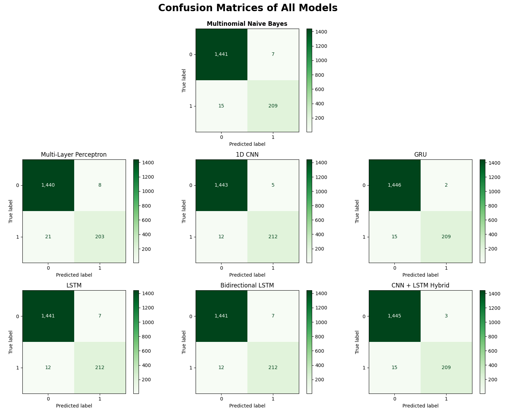
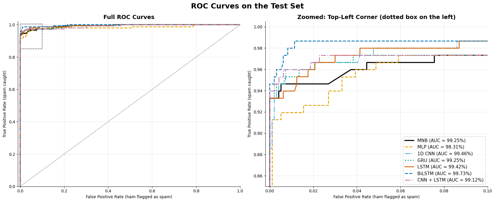

# Executive Summary

This project aims to compare the performance of the Naive Bayes classifiers—**Multinomial Naive Bayes** to be exact—with various neural network architectures including **MLP**, **1D CNN**, **LSTM**, **BiLSTM**, **GRU**, and a **CNN + LSTM Hybrid** model for SMS spam detection using the SMS Spam Collection Dataset from the UCI Machine Learning Repository. This project is an extension of the [this project](https://github.com/tasnimtalha09/introduction-to-naive-bayes-classifiers) where we explored and compared three Naive Bayes models.

The dataset contained roughly **87% ham** and **13% spam**, showing a natural imbalance. The analysis focused on model performance, overfitting checks, and generalization ability through metrics like **accuracy, precision, recall, F1-score**, and **ROC-AUC**.

***Figure 01:** Ham vs. Spam Distribution.*

# Business Problem
With the rising volume of spam in digital communication, automated detection is critical for both user safety and system efficiency. The business problem addressed is:  

> *Can we accurately classify SMS messages as spam or ham using probabilistic learning methods or neural network models while balancing false positives (legitimate messages flagged as spam) and false negatives (spam messages passing through)?*

This project evaluates **seven** models—one naive bayes model and six neural network architectures—to identify the most effective approach for spam detection. Our goal is to determine which provides the best trade-off between accuracy, recall, and precision for real-world spam filtering applications.

# Methodology

## Data Preparation
As can be seen from the pie chart above, the dataset is imbalanced with a higher proportion of ham messages compared to spam messages. The data is split into **three** sets, each with a different role:

* **Training set (64%):** the data the models learn from.
* **Validation set (16%):** the data used to make decisions during development, such as when the neural networks should stop training (early stopping) and, later, which model performs best.
* **Test set (20%):** the data kept untouched for the final evaluation of the models.

Both splits use **stratified sampling** (via `stratify = sms["label_encoding"]`) so the proportion of ham and spam messages (about 87:13) is preserved in all three sets. Using a separate validation set means the test set is not involved in any decision, so the final test results are a fair estimate of how the models will perform on unseen messages.

The **seven** models require **three** different types of encoders:
1. **Multinomial Naive Bayes**: `CountVectorizer()` bundled in a scikit-learn `Pipeline`
2. **Multi-Layer Perceptron**: `TfidfVectorizer()` (fitted on training set only)
3. **All The Other Neural Networks**: `Tokenizer()` and `pad_sequences()`

Using pipelines for MNB prevents **preprocessing leakage** during cross-validation—each pipeline learns its vocabulary and IDF weights only from the data used to fit it.

## Model Training & Performance Evaluation
The **seven** models evaluated are:
1. Multinomial Naive Bayes
2. Multi-Layer Perceptron (MLP)
3. 1D Convolutional Neural Network (CNN)
4. Long Short-Term Memory (LSTM)
5. Bidirectional LSTM (BiLSTM)
6. Gated Recurrent Unit (GRU)
7. CNN + LSTM Hybrid

All neural networks share the same training settings: **50 max epochs**, **10 patience** (early stopping), and **batch size 32**, so that differences come from the architecture and not from the training setup. Models were selected on the **validation set** and the **test set** was reported once for a fair final evaluation.

### Overfitting Check
Before comparing the model performance metrics, we want to check whether any of the models have any overfitting issues. Because only about 13% of messages are spam, accuracy can hide issues, so we compare the **spam F1-score on the training set against the validation set**. The gap is **Train F1 − Validation F1**: a positive gap means the model does better on the data it learned from.

***Table 01:** Train-Validation F1 Gap.*

| **Model** | **Train F1** | **Validation F1** | **F1 Gap** |
|:----------|:---------------------------:|:---------------------------:|:---------------------------:|
| Multinomial Naive Bayes | 98.22% | 92.18% | 6.04% |
| Multi-Layer Perceptron | 99.17% | 92.17% | 6.99% |
| 1D CNN | 99.48% | 95.32% | 4.16% |
| GRU | 99.58% | 96.14% | 3.44% |
| LSTM | 99.58% | 95.76% | 3.82% |
| BiLSTM | 99.37% | 95.04% | 4.33% |
| CNN + LSTM Hybrid | 100.00% | 94.83% | 5.17% |

**Key Insights:**

* Every model scores higher on the training set than on the validation set (gaps of **3.44 to 6.99 percentage points**), so some overfitting is present in all seven.
* The **GRU** has both the smallest gap (**3.44%**) and the highest validation F1 (**96.14%**), followed by the **LSTM** (3.82%; 95.76%) and the **1D CNN** (4.16%; 95.32%).
* The two bag-of-words models trail the sequence models: **MNB** (92.18%) and the **MLP** (92.17%) score about 3 to 4 points lower on validation than the five sequence models, roughly 6 to 10 more mistakes out of 892 validation messages. The **MLP** also has the largest gap (**6.99%**).
* Among the five sequence models, validation F1 differs by only about 1.3 points (a few messages), too small to rank them with confidence on a single split.

### Model Performance Comparison
Models are ranked by **validation F1**, the metric used to select the model. The **test-set** metrics are reported alongside as the final measure of performance on unseen messages.

***Table 02:** Model Performance Comparison — Ranked by Validation F1 (Spam / Class 1).*

| **Rank** | **Model** | **Validation F1** | **Test F1** | **Test Precision** | **Test Recall** | **Test Accuracy** | **Test ROC-AUC** | **F1 Gap** | **Parameters** |
|:--------:|:----------|:------------:|:-------------:|:----------:|:------------:|:-----------:|:---------------:|:--:|--:|
| 1 | GRU | **96.14%** | 95.89% | 97.90% | 93.96% | 98.92% | 99.25% | **3.44%** | 679,361 |
| 2 | LSTM | 95.76% | 95.53% | 97.89% | 93.29% | 98.83% | 99.42% | 3.82% | 691,521 |
| 3 | 1D CNN | 95.32% | 95.56% | 97.22% | 93.96% | 98.83% | 99.46% | 4.16% | 732,417 |
| 4 | BiLSTM | 95.04% | **96.93%** | **98.61%** | **95.30%** | **99.19%** | **99.73%** | 4.33% | 742,977 |
| 5 | CNN + LSTM | 94.83% | 95.92% | 97.24% | 94.63% | 98.92% | 99.12% | 5.17% | 716,161 |
| 6 | ***MNB*** | ***92.18%*** | ***95.56%*** | ***97.22%*** | ***93.96%*** | ***98.83%*** | ***99.25%*** | ***6.04%*** | ***13,288*** |
| 7 | MLP | 92.17% | 94.77% | 98.55% | 91.28% | 98.65% | 98.31% | 6.99% | 1,746,177 |

**Key Insights:**

* **There is no clear winner.** On the test set all seven models are within half a point of accuracy (98.65% to 99.19%), which is only 9 to 15 mistakes out of 1,115 messages.
* **Validation and test disagree, and that is noise.** The **GRU** is best on validation F1 (96.14%) but third on test (95.89%). The **BiLSTM** is the reverse (95.04% on validation, best on test at 96.93%). With only about 120 to 149 spam messages per set, a single message moves recall by roughly 0.7 points.
* **Selected model: GRU**, because it had the best validation F1, the rule we fixed before looking at the test set. This is a tie-break, not proof that it is better.
* **Naive Bayes holds its own.** Its test F1 (95.56%) matches the 1D CNN and edges past the LSTM (95.53%), with just 13,288 parameters against 679,361 to 742,977 for the sequence models.
* **The MLP is the weakest.** It has the lowest test F1 (94.77%), recall and ROC-AUC, the biggest overfitting gap (6.99%), and the most parameters (1,746,177). More parameters did not buy better results.
* **Models differ on missed spam, not false alarms.** Precision is 97% to 99% for all of them, so the gaps come from recall (91.28% to 95.30%).

**Bottom line:** the neural networks offer, at best, a small and uncertain gain over Naive Bayes on this dataset.

### Confusion Matrices
We combined all the confusion matrices of the seven models into a single plot for easier comparison.

***Figure 02:** Confusion Matrices.*

**Key Insights:**

Our goal is to keep both kinds of mistakes low, but which one matters more depends on the context. For a spam filter, a false positive (a real message lost in the spam folder) usually costs more than a false negative (a spam message that slips into the inbox).

* **Fewest false positives** *(ham messages incorrectly predicted as spam)*: The **MLP** and **BiLSTM** are best with only **2** each, followed by the **GRU** and **LSTM** with **3**. The other three models, including MNB, have **4**.
* **Fewest false negatives** *(spam messages incorrectly predicted as ham)*: The **BiLSTM** leads with only **7**, followed by the **CNN + LSTM Hybrid** with **8**. The **MLP** misses the most spam (**13**).
* **Fewest total errors:** The **BiLSTM** makes just **9** mistakes out of 1,115 messages (2 false positives and 7 false negatives), compared with 12 to 15 for every other model.
* **The validation-selected GRU** makes **12** mistakes (**3** false positives, **9** false negatives), only three more than the BiLSTM.

Compared with the neural networks, MNB stays highly competitive with **4** false positives and **9** false negatives. Its matrix is identical to the 1D CNN's, and it misses less spam than the LSTM (**10**) and the MLP (**13**).

### ROC AUC Curves
We combined all the ROC AUC curves of the seven models into a single plot for easier comparison.

***Figure 03:** ROC AUC Curves.*

**Key Insights:**
* **All seven curves hug the top-left corner**, with AUCs from **98.31% (MLP) to 99.73% (BiLSTM)**. Any of them ranks a random spam message above a random ham message at least 98.3% of the time. The zoomed panel is needed to tell the curves apart.
* **A spread of 1.4 points of AUC is small**, which backs up the earlier result: no model is clearly better.
* **The AUC order does not match the F1 order.** AUC looks at every possible threshold, while F1 only reflects the 0.5 cut-off we used. A model can rank messages well but sit on a poorly placed threshold.
* **That points to a cheap improvement we did not make.** Because missed spam is the main error, lowering the threshold (chosen on the validation set) could catch more spam for a few extra false alarms. We kept 0.5 for every model to keep the comparison simple.

## Best Model Selection
Based on the comprehensive evaluation, the **Gated Recurrent Unit (GRU)** is the selected model because it had the highest validation F1 (**96.14%**) and the smallest overfitting gap (**3.44%**). However, this is a tie-break, not proof that it is clearly better.

If we put the numbers of GRU and Multinomial Naive Bayes side by side, we get the following table:

***Table 03:** GRU vs. Multinomial Naive Bayes Performance Comparison.*

| ***Metric*** | **Multinomial Naive Bayes** | **Gated Recurring Unit** | **Better Model** |
|:-----------|:---------------------------:|:---------------------:|:--------------:|
| ***Validation F1*** | 92.18% | 96.14% | GRU |
| ***Test Accuracy*** | 98.83% | 98.92% | GRU |
| ***Test Precision*** | 97.22% | 97.90% | GRU |
| ***Test Recall*** | 93.96% | 93.96% | Tied |
| ***Test F1-Score*** | 95.56% | 95.89% | GRU |
| ***Test ROC-AUC*** | 99.25% | 99.25% | Tied |
| ***F1 Gap (Overfitting)*** | 6.04% | 3.44% | GRU |
| ***Parameters*** | 13,288 | 679,361 | MNB |

For a quick summary, here are the key performance metrics of the **GRU** model:
* **Validation F1:** 96.14%. Highest among all models, the selection criterion
* **Test Accuracy:** 98.92%. Strong overall correctness on unseen data
* **Test Precision:** 97.90%. Strong at minimizing false positives, crucial for user trust
* **Test Recall:** 93.96%. Tied with MNB and 1D CNN
* **Test F1-Score:** 95.89%. Reflects a strong balance between precision and recall
* **Test ROC-AUC:** 99.25%. Excellent class separability
* **F1 Gap:** 3.44%. Smallest of all models, demonstrating the best generalization

# Conclusion

This project compared **Multinomial Naive Bayes** against **six neural network architectures** for SMS spam detection, using a **train-validation-test split** in which models were selected on the validation set and the test set was reported once. The main finding is that **the neural networks did not clearly outperform the traditional baseline**. On the validation set they led Naive Bayes by about **2.7 to 4.0 points of F1**, but on the test set the gap disappeared: their F1 ranged from 0.8 points below to 1.4 points above Naive Bayes (**95.56%**).

The **Gated Recurrent Unit (GRU)** was selected as the final model because it had the highest validation F1 (**96.14%**) and the smallest overfitting gap (**3.44%**). On the test set it achieved **98.92% accuracy**, **97.90% precision**, **93.96% recall** and a **95.89% F1-score**, making only 12 mistakes out of 1,115 messages. The **BiLSTM** scored highest on the test set (**96.93% F1**, 9 mistakes), but it ranked fourth on validation, so it was not chosen after the fact.

**Final Model Ranking (by Validation F1):**
|***Rank***| **Model** | **Validation F1** | **Test F1** |
|:---|:---------------------------|:------------------:|:------------------:|
|***01.*** | **Gated Recurrent Unit** | **96.14%** | **95.89%** |
|***02.*** | *Long Short-Term Memory* | 95.76% | 95.53% |
|***03.*** | *1D Convolutional Neural Network* | 95.32% | 95.56% |
|***04.*** | *Bidirectional LSTM* | 95.04% | 96.93% |
|***05.*** | *CNN + LSTM Hybrid* | 94.83% | 95.92% |
|***06.*** | **Multinomial Naive Bayes** | **92.18%** | **95.56%** |
|***07.*** | *Multi-Layer Perceptron* | 92.17% | 94.77% |

**Key Takeaway:** All seven models make between 9 and 15 mistakes on the test set, so the differences between them are a handful of messages. Multinomial Naive Bayes, with only **13,288 parameters** compared with 680,000 to 1.7 million for the neural networks, remains a strong and practical baseline. The GRU is the recommended model by our selection rule, but the evidence does not justify calling it clearly better than Naive Bayes.

**Limitations:** The results come from a **single data split and a single random seed**, with only about 120 (validation) and 149 (test) spam messages, so one message moves recall by roughly 0.7 points. The validation set was also used to stop training, so the networks' validation scores are slightly optimistic compared with Naive Bayes. Repeating the experiment over several seeds or with cross-validation would give confidence intervals and show whether the small differences are real.

